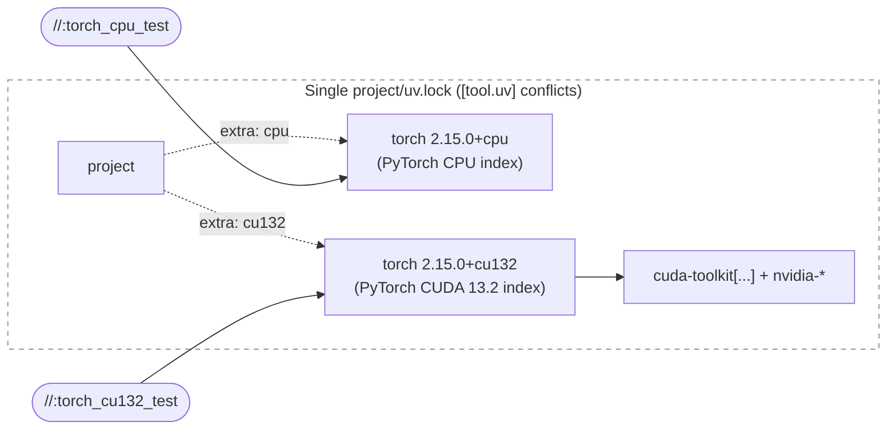

# Conflicting extras (`torch` CPU vs CUDA)

This scenario uses the setup from uv's PyTorch documentation in [`project/pyproject.toml`](project/pyproject.toml):

- The `cpu` and `cu132` extras both depend on `torch`.
- `[tool.uv] conflicts` declares `cpu` and `cu132` mutually exclusive.
- `[tool.uv.sources]` routes `torch` to the PyTorch CPU or CUDA 13.2 index depending on the extra.

One [`project/uv.lock`](project/uv.lock) holds `torch 2.15.0+cpu` and `torch 2.15.0+cu132` on separate forks, with the `nvidia-*` and `cuda-*` wheels only on the CUDA fork. Each Bazel module provides `//:torch_cpu_test` and `//:torch_cu132_test`, and both must pass in one `bazel test //...` invocation on Python 3.12 (Linux x86_64). The CUDA test checks `torch.version.cuda` and does not need a GPU.

## Comparison

| | [rules_python](rules_python/README.md) | [rules_pycross](rules_pycross/README.md) | [rules_py](rules_py/README.md) |
| --- | --- | --- | --- |
| Reads `[tool.uv] conflicts` | No | Yes | No ([#1510](https://github.com/aspect-build/rules_py/issues/1510)) |
| Naive setup (shared `uv.lock`) | Fails during extension evaluation: `attempting to override an existing repo ... torch ...` | Fails analysis: `No uv conflict variant selected. Set one of the _variants flags ...`. Passing the flag works | `torch` is absent from the hub because extras are never activated. Mapping extras to groups builds, but CUDA fails at import (`libcudart.so.13: cannot open shared object file`) because the conflict-gated `cuda-toolkit[...]` edge is dropped |
| Working setup | Maintain one `pyproject.toml` and `uv.lock` per variant (`variants/cpu`, `variants/cu132`), pass each to `pip.parse(uv_lock = ...)` on its own hub (`pypi_cpu`, `pypi_cu132`), and select via the unified `@pypi` hub (`py_test(config_settings = {"@rules_python//python/config_settings:venv": ...})`). Alternatively, derive `requirements.txt` from the shared lock via `uv export --frozen --extra <v>` (see module README for its caveats) | Use the shared `uv.lock` unchanged with one `uv.repo` (`@pypi`) covering both extras, register `@pypi//_variants` with `rules_python`'s `config.add_transition_setting`, and pick the variant per target via `py_test(config_settings = {"@pypi//_variants": "extra_<v>"})`. Per-variant `uv.repo` views also work | Keep a separate `pyproject.toml` and `uv.lock` per variant (no extras, no conflicts), register both on one hub, and pick them with `py_test(dep_group = ...)` |
| How targets pick a variant | `config_settings` on `@rules_python//python/config_settings:venv` (unified `@pypi` hub), concrete hub name (`@pypi_cpu` / `@pypi_cu132`), or global flag | `config_settings` on `@pypi//_variants` (target transition), repo name (repo transition), or a global flag | `dep_group` on the test/binary (transition) or a global flag |
| Uses shared `uv.lock` as-is | No (per-variant `uv.lock` files; or `uv export` to `requirements.txt`) | Yes | No (per-variant locks). Sharing one lock works only if you copy the `cuda-toolkit[...]` edge by hand |
| Extra maintenance | Maintain and relock two separate variant locks (or export scripts, `experimental_index_url_overrides`, and restoring stripped extras if using `uv export`) | None | Maintain and relock two separate variant locks |

## Modules

- [`rules_python/`](rules_python/README.md) (rules_python 2.5.1)
- [`rules_pycross/`](rules_pycross/README.md) (rules_pycross 2.2.0)
- [`rules_py/`](rules_py/README.md) (rules_py 2.0.0-alpha.11)
