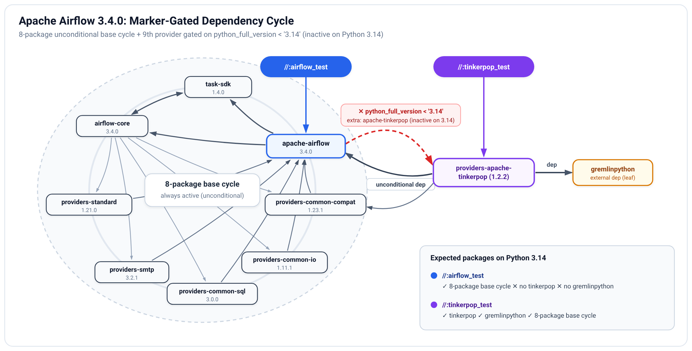
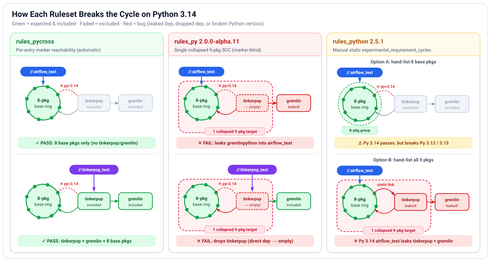

# Marker-gated cyclic dependencies (Apache Airflow)

Python package metadata allows circular dependencies, while Bazel's target graph must be acyclic. [`project/`](project) locks a real PyPI cycle from Apache Airflow:

- `apache-airflow==3.4.0` has an 8-package overlapping base cycle (`apache-airflow`, `apache-airflow-core`, `apache-airflow-task-sdk`, `apache-airflow-providers-common-compat`, `apache-airflow-providers-common-io`, `apache-airflow-providers-common-sql`, `apache-airflow-providers-smtp`, and `apache-airflow-providers-standard`).
- Its `apache-tinkerpop` extra adds a 9th cycle member (`apache-airflow-providers-apache-tinkerpop==1.2.2`, which depends on `gremlinpython`) behind the marker `python_full_version < '3.14'`.
- `apache-airflow-providers-apache-tinkerpop` depends back on `apache-airflow` unconditionally.

On Python 3.14 (Linux x86_64), each module tests two entry points in [`project/src/check_cycle.py`](project/src/check_cycle.py):

- `//:airflow_test` (`deps = ["apache_airflow"]`) checks that `airflow` and `airflow.providers.standard` are importable and that `tinkerpop` and `gremlin_python` are absent.
- `//:tinkerpop_test` (`deps = ["apache_airflow_providers_apache_tinkerpop"]`) depends directly on `tinkerpop` and checks that `tinkerpop`, `gremlin_python`, `airflow`, and `airflow.providers.standard` are all importable.

## Dependency graph

## How each ruleset resolves the cycle on Python 3.14

## Comparison

| | [rules_python](rules_python/README.md) | [rules_pycross](rules_pycross/README.md) | [rules_py](rules_py/README.md) |
| --- | --- | --- | --- |
| Detects cycles automatically | No | Yes | Yes |
| Naive setup (shared `uv.lock`) | Fails analysis with `cycle in dependency graph` across Airflow's 8 overlapping cycle packages | Works out of the box (both tests pass) | Builds, but both tests fail: `//:airflow_test` leaks `gremlin_python`, and `//:tinkerpop_test` drops `tinkerpop` itself while keeping `gremlin_python` |
| Working setup | List all 8 base Airflow packages by hand in `experimental_requirement_cycles` (breaks Python 3.12/3.13). Listing all 9 over-includes `tinkerpop` and `gremlin_python` on 3.14 | Shared `uv.lock` unchanged, no extra configuration | Only `//:airflow_imports_test` (which ignores leaked packages) passes; no `MODULE.bazel` setting fixes `//:airflow_test` or `//:tinkerpop_test` on 3.14 without editing `uv.lock` |
| How the cycle is broken | Collapses listed packages into one static group target (marker-unaware) | Detects SCCs automatically; generates per-member `_raw_*` targets plus marker-aware `pycross_cycle_member_marker_deps` wrappers | Detects SCCs without checking markers; collapses all 9 packages into one `py_library`, unions all external deps, and gates each member on its inbound intra-SCC edge markers |
| Uses shared `uv.lock` as-is | Yes | Yes | Yes (with both strict tests failing) |
| Extra maintenance | Discover and merge all 8 (or 9) Airflow packages in `experimental_requirement_cycles`, choosing between breaking Python 3.12/3.13 or over-including on 3.14 | None | None for basic imports; broken when a cycle member's inbound edge is inactive |

## Modules

- [`rules_python/`](rules_python/README.md) (rules_python 2.5.1)
- [`rules_pycross/`](rules_pycross/README.md) (rules_pycross 2.2.0)
- [`rules_py/`](rules_py/README.md) (rules_py 2.0.0-alpha.11)
