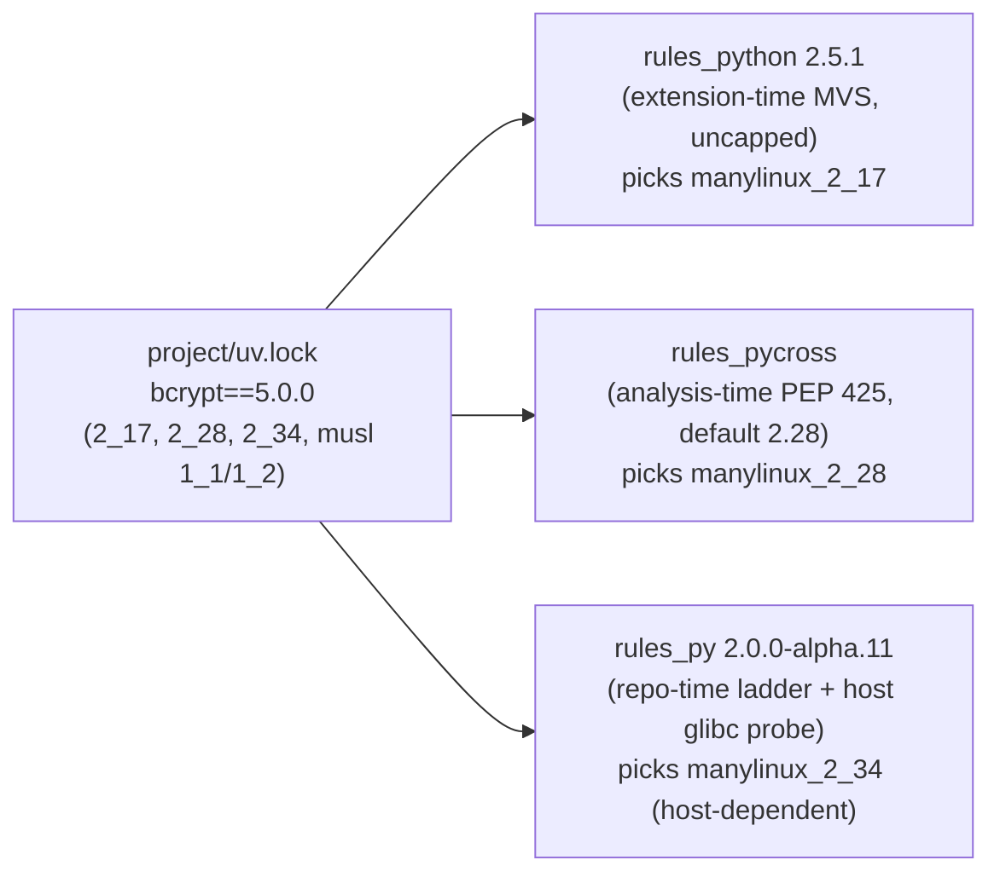

# Wheel selection across glibc and musl (`bcrypt` and `cbor2`)

When a package ships multiple Linux wheels in one `uv.lock`, how does each Bazel ruleset decide
which wheel to pick by default, how do you cap glibc for an older deployment target (such as RHEL 7
/ glibc 2.17), and how do you target Alpine / musl (`musllinux`)?

[`project/`](project) locks two small, zero-dependency C/Rust extension packages on Python 3.14
(Linux x86_64):

- `bcrypt==5.0.0`: ships 10 Linux x86_64 `abi3` wheels (`cp38-abi3` and `cp39-abi3` across
  `manylinux_2_17`, `manylinux_2_28`, `manylinux_2_34`, `musllinux_1_1`, and `musllinux_1_2`).
- `cbor2==6.3.0`: ships only `manylinux_2_28` and `musllinux_1_2` wheels for `cp314` (no
  `manylinux_2_17` wheel), plus an sdist.

On the exact same Linux x86_64 machine (Debian, host glibc 2.43), the three rulesets pick **three
different default wheels** for `bcrypt==5.0.0`:

Each module inspects the selected wheel `Tag:` in [`project/src/check_wheel.py`](project/src/check_wheel.py)
across default Linux x86_64, glibc `2.17`, glibc `2.34`, musl `1.2`, and musl `1.1`, plus checks
what happens to `cbor2` when glibc is capped to `2.17`.

## Comparison

| | [rules_python](rules_python/README.md) | [rules_pycross](rules_pycross/README.md) | [rules_py](rules_py/README.md) |
| --- | --- | --- | --- |
| When wheel selection happens | Module-extension time (`select_whl.bzl`) | Analysis time (`pycross_wheel_chooser` + `pypackaging.tags` `FeatureFlagInfo`) | Repo-generation time (`select_chain` alias ladder + `@rules_py_uv_host`) |
| Default `bcrypt` wheel (Linux x86_64) | `cp39-abi3-manylinux_2_17_x86_64` (MVS lowest) | `cp39-abi3-manylinux_2_28_x86_64` (deterministic default `2.28`) | `cp39-abi3-manylinux_2_34_x86_64` (probed from host glibc; varies by machine) |
| Default `cbor2` wheel (Linux x86_64) | `cp314-cp314-manylinux_2_28_x86_64` (uncapped `manylinux_*` mixes `2_17` and `2_28`) | `cp314-cp314-manylinux_2_28_x86_64` | `cp314-cp314-manylinux_2_28_x86_64` |
| Targeting glibc `2.34` (`bcrypt`) | Still picks `manylinux_2_17` even on a custom `manylinux_2_34_x86_64` platform (MVS prefers lowest) | Picks `manylinux_2_34` via `--@rules_pycross//pycross/settings:glibc_version=2.34` | Picks `manylinux_2_34` via `--@rules_py//uv/private/constraints/platform:platform_version=2.34` |
| Targeting glibc `2.17` (`bcrypt` + `cbor2`) | Requires custom `pip.default` platform + `download_only = True`; `bcrypt` -> `2_17`, `cbor2` -> analysis error | Zero `MODULE.bazel` changes (`glibc_version=2.17`); `bcrypt` -> `2_17`, `cbor2` -> rejected cleanly (or auto-builds sdist if `build_mode = "auto"`) | `platform_version=2.17`; `bcrypt` -> `2_17`, `cbor2` -> falls back to sdist build (`No module named build` unless build tools are in lock) |
| Targeting musl `1.2` / `1.1` (Alpine) | No built-in musl platform; requires custom `pip.default` + `target_platforms`; MVS picks `musllinux_1_1` for `bcrypt` even on a `musllinux_1_2` platform | Zero `MODULE.bazel` changes (`py_linux_libc=musl`, `musl_version=1.2` or `1.1`); picks `musllinux_1_2` / `musllinux_1_1` cleanly | Zero `MODULE.bazel` changes (`platform_libc=musl`, `platform_version=1.2` or `1.1`); picks `musllinux_1_2` / `musllinux_1_1` cleanly |
| Deterministic across Linux build hosts | Yes (fixed MVS), but default `manylinux_*` has no upper glibc cap | Yes (`DEFAULT_GLIBC_VERSION = "2.28"`) | No by default (`@rules_py_uv_host` probes the host's glibc version) |
| Uses shared `uv.lock` as-is | Yes | Yes | Yes |

## Modules

- [`rules_python/`](rules_python/README.md) (rules_python 2.5.1)
- [`rules_pycross/`](rules_pycross/README.md) (rules_pycross 2.2.0)
- [`rules_py/`](rules_py/README.md) (rules_py 2.0.0-alpha.11)
