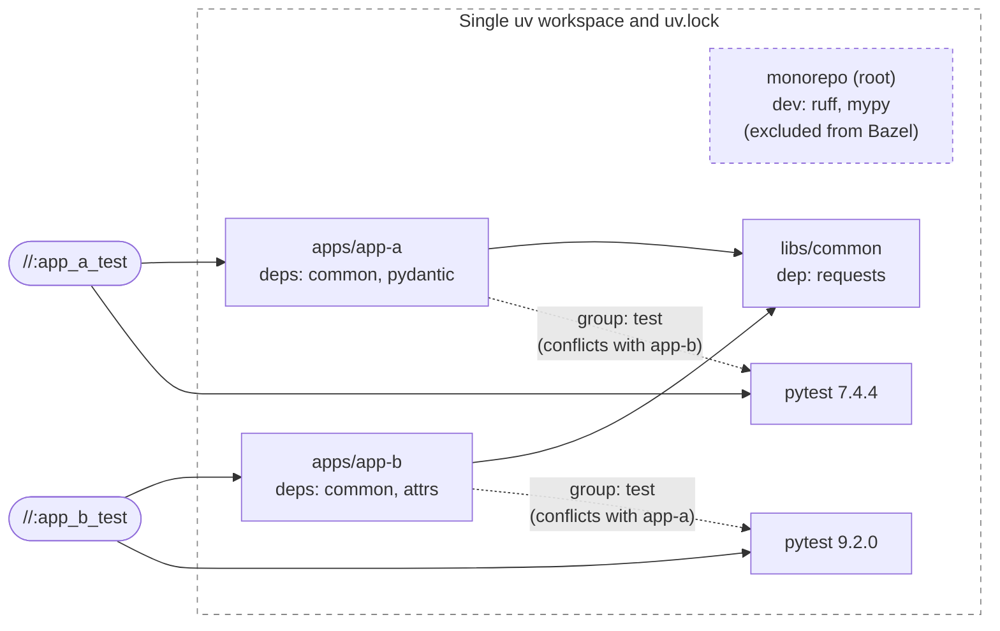

# uv workspace with conflicting dependency groups

This scenario comes from a common question about uv workspaces in Bazel: given one workspace and one lock file, how do you expose a single hub with every member's runtime dependencies while leaving a root `dev` group (linters, type stubs) out of Bazel, without editing `[dependency-groups]` in the root `pyproject.toml` or maintaining a member list by hand?

[`project/`](project) sets up that workspace on Python 3.14 (Linux x86_64):

- The root `monorepo` package (`package = false`) defines `[dependency-groups] dev = ["ruff", "mypy"]`.
- `libs/common` depends on `requests`.
- `apps/app-a` depends on `common` and `pydantic`, and has a `test` group requiring `pytest < 8`.
- `apps/app-b` depends on `common` and `attrs`, and has a `test` group requiring `pytest >= 8`.
- The two `test` groups are declared conflicting, so [`project/uv.lock`](project/uv.lock) carries `pytest 7.4.4` and `pytest 9.2.0` on separate forks.
- Members are hatchling packages, and Bazel builds their first-party code directly from `src/`.

Each Bazel module builds `//:common`, `//:app_a`, and `//:app_b`, and runs `//:app_a_test` (`pytest 7.4.4`) and `//:app_b_test` (`pytest 9.2.0`) in one `bazel test //...` invocation.

## Comparison

| | [rules_python](rules_python/README.md) | [rules_pycross](rules_pycross/README.md) | [rules_py](rules_py/README.md) |
| --- | --- | --- | --- |
| Where hub contents are chosen | Exported requirements files (`uv export --all-packages --no-dev`, `--package app-a --group test`, ...) | `MODULE.bazel`: `uv.repo(projects = ["*"], dependency_groups = ["default"])` | The root pyproject's `[dependency-groups]`. Without that table, rules_py creates one implicit group of all `[manifest].members` |
| All members, no `dev`, no hand-kept member list | Yes, via `uv export --all-packages --no-dev` | Yes; `dev` is not selected and the root `pyproject.toml` stays untouched | Only by passing a Bazel-only stub `pyproject.toml` with no `[dependency-groups]` so the real root file is never read |
| Naive setup (shared lock + root pyproject) | Fails during extension evaluation: `attempting to override an existing repo ... pytest ...` (walks every dev-dependency edge, including `dev`) | Works | Fails during extension evaluation: `Editable package app_a ... doesn't have a mandatory uv.override_package(target = ...)`. Once overrides are added, the hub only contains `dev`, so `pydantic` is missing |
| `pytest` 7 / 9 split | One hub. Each exported file binds to a custom `pip.default` platform keyed on a `//:deps` flag, set per test via `config_settings` | Per-member test repos (`projects = ["app-a"]`, `group:test;testonly`); each selects its variant automatically without `flags` or `config_settings` (a single `@pypi` hub with `config_settings` on `@pypi//_variants` also works) | Member groups are ignored, so they are restated as root groups (`app-a-test = ["app-a", "pytest>=7,<8"]`) and selected with `py_pytest_test(dep_group = ...)` |
| Workspace members | Dropped (`-e` lines ignored; uses `--no-emit-workspace`) | Treated as projects with no targets or overrides; member-to-member dependencies are flattened | Each editable member requires `uv.override_package(target = ...)` |
| Uses shared `uv.lock` as-is | No (exported requirements files) | Yes | Yes, with two Bazel-only stub `pyproject.toml` files |

## Modules

- [`rules_python/`](rules_python/README.md) (rules_python 2.5.1)
- [`rules_pycross/`](rules_pycross/README.md) (rules_pycross 2.2.0)
- [`rules_py/`](rules_py/README.md) (rules_py 2.0.0-alpha.11)
